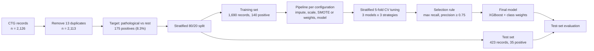
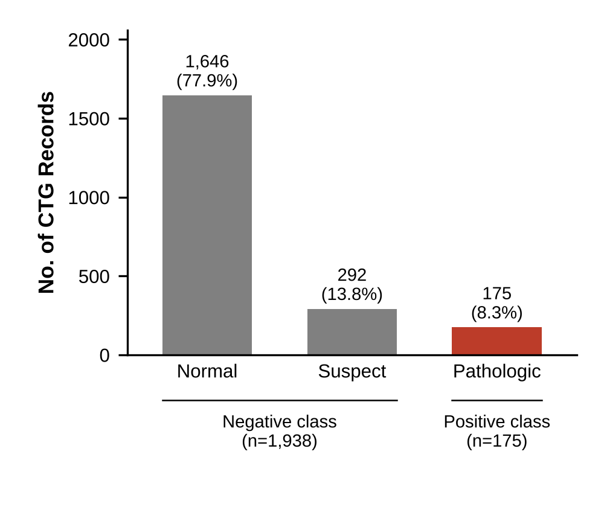
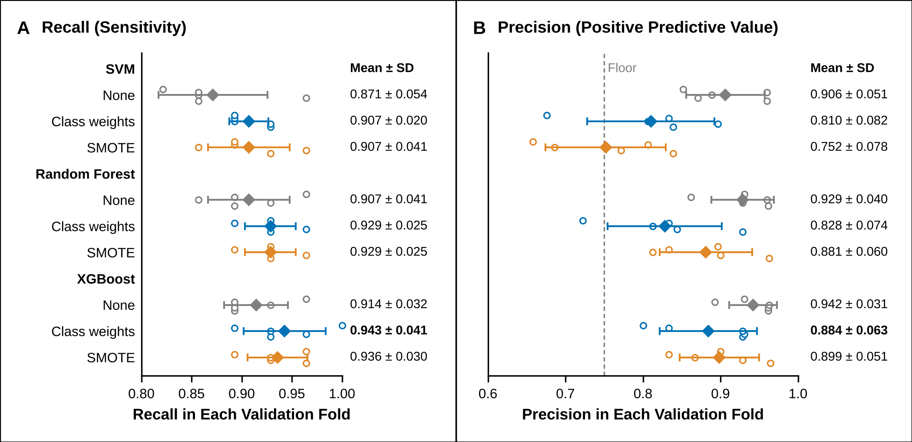
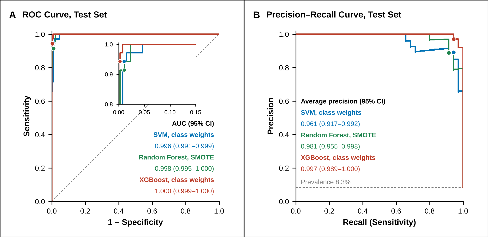
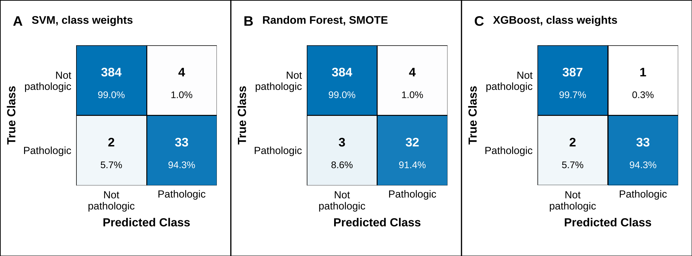
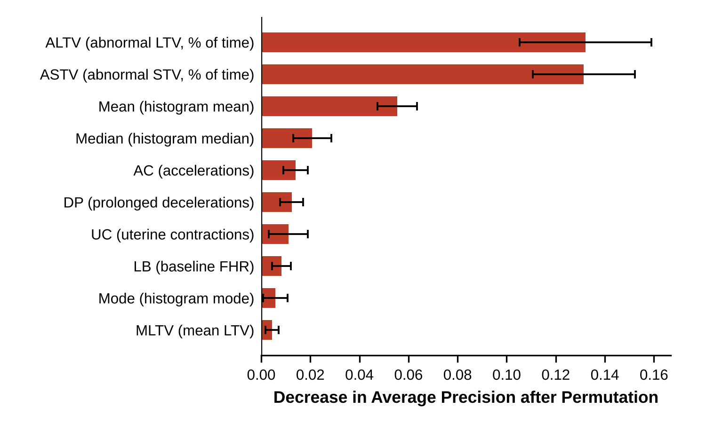

# Progree ML Task 4: High-Imbalance Clinical Disease Predictor

This project detects pathological fetal heart rate traces in cardiotocography (CTG) records. Only 8.3% of the records are pathological. SVM, random forest and XGBoost are each trained with no imbalance handling, with class weights and with SMOTE. Hyperparameters are tuned by stratified 5-fold cross-validation to maximise recall (sensitivity).

**Final model: XGBoost with class weights.** On the held-out test set it found 33 of 35 pathological traces (recall 0.943) and raised 1 false alarm among 388 other traces (precision 0.971, specificity 0.997).

The full write-up is in [report/Task4_Report.pdf](report/Task4_Report.pdf). An editable Word copy is in the same folder.

## Task

Progree Machine Learning Internship, Task 4 (mini project): load a high-imbalance diagnostic dataset; apply SMOTE or adjusted class weights; train and tune SVM, random forest and XGBoost; evaluate and maximise recall, backed by cross-validation arrays; write a 5–6 page report.

## Requirements checklist

| Requirement | Where it is met |
|---|---|
| High-imbalance diagnostic dataset (UCI) | UCI Cardiotocography, 8.3% positive (11.1 negatives per positive) |
| SMOTE or adjusted class weights | Both, plus an unadjusted baseline; SMOTE runs inside each training fold |
| SVM, random forest, XGBoost | `build_pipeline` in `src/train.py` |
| Hyperparameter tuning | SVM grid search (42 candidates); random search for random forest and XGBoost (30 candidates each) |
| Maximise recall | Highest mean CV recall with mean CV precision ≥ 0.75 |
| Cross-validation arrays | Recall in each of the 5 folds: table below, Figure 2, `results/cv_recall_folds.csv` |
| Report (5–6 pages) | `report/Task4_Report.pdf` |

## Dataset

- **Source:** Cardiotocography dataset, UCI Machine Learning Repository ([doi:10.24432/C51S4N](https://doi.org/10.24432/C51S4N)), CC BY 4.0. The data come from 2,126 CTG recordings processed by the SisPorto program (Ayres de Campos et al., 2000). Each recording was classified by three expert obstetricians as normal, suspect or pathological (the NSP label).
- **File:** `data/fetal_health.csv`, a copy of the UCI data (Hugging Face: `sayanroy058/Fetal_Health_Classification`). Its record and class counts match the UCI documentation: 2,126 records; 1,655 normal, 295 suspect and 176 pathological.
- **Cleaning:** 13 exact duplicate rows were removed, leaving 2,113 records. There are no missing values.
- **Features:** 21 numeric features, named with the UCI codes. They cover the baseline heart rate (LB), accelerations (AC), fetal movements (FM), uterine contractions (UC), light, severe and prolonged decelerations (DL, DS, DP), short- and long-term variability (ASTV, MSTV, ALTV, MLTV) and the FHR histogram (Width, Min, Max, Nmax, Nzeros, Mode, Mean, Median, Variance, Tendency).
- **Target:** pathological (NSP = 3) = 1; normal or suspect = 0. There are 175 positives (8.3%).

## Pipeline



- **Preprocessing:** median imputation and standard scaling. The imputer is kept so the pipeline can handle missing values in new data.
- **Imbalance handling:**
  - Class weights: `class_weight="balanced"` for the SVM, `"balanced_subsample"` for the random forest, and `scale_pos_weight` = 11.07 (negatives/positives) for XGBoost.
  - SMOTE: `imblearn` pipeline, so synthetic cases are made from training folds only.
- **Validation:** the same five stratified folds (28 pathological traces each) for all nine configurations. Every candidate is scored on recall, precision, specificity, F2, ROC-AUC and average precision.
- **Selection rule:** highest mean recall among candidates with mean precision ≥ 0.75; ties are broken by F2. The rule is applied within each configuration and then across the nine tuned configurations. The test set is used only after the final model is fixed.

## Results

### Cross-validation arrays (training set, 5 folds)

Recall of the selected candidate in each validation fold. "Detected" and "False alarms" are summed over the five folds (140 pathological and 1,550 other traces). The final model is in bold.

| Model | Imbalance handling | Recall in folds 1–5 | Mean recall ± SD | Mean precision | Detected (of 140) | False alarms |
|---|---|---|---|---|---|---|
| SVM | None | 0.857, 0.964, 0.857, 0.857, 0.821 | 0.871 ± 0.054 | 0.906 | 122 | 13 |
| SVM | Class weights | 0.929, 0.929, 0.893, 0.893, 0.893 | 0.907 ± 0.020 | 0.810 | 127 | 31 |
| SVM | SMOTE | 0.929, 0.964, 0.857, 0.893, 0.893 | 0.907 ± 0.041 | 0.752 | 127 | 43 |
| Random Forest | None | 0.893, 0.929, 0.857, 0.893, 0.964 | 0.907 ± 0.041 | 0.929 | 127 | 10 |
| Random Forest | Class weights | 0.929, 0.964, 0.929, 0.893, 0.929 | 0.929 ± 0.025 | 0.828 | 130 | 28 |
| Random Forest | SMOTE | 0.929, 0.964, 0.929, 0.893, 0.929 | 0.929 ± 0.025 | 0.881 | 130 | 18 |
| XGBoost | None | 0.893, 0.893, 0.929, 0.893, 0.964 | 0.914 ± 0.032 | 0.942 | 128 | 8 |
| **XGBoost** | **Class weights** | **0.929, 0.964, 0.929, 0.893, 1.000** | **0.943 ± 0.041** | **0.884** | **132** | **18** |
| XGBoost | SMOTE | 0.964, 0.929, 0.929, 0.893, 0.964 | 0.936 ± 0.030 | 0.899 | 131 | 15 |

### Test set (423 records, 35 pathological)

| Model | Imbalance handling | Recall | Precision | Specificity | F2 | ROC-AUC | Average precision | TP | FN | FP | TN |
|---|---|---|---|---|---|---|---|---|---|---|---|
| SVM | None | 0.943 | 0.917 | 0.992 | 0.938 | 0.996 | 0.959 | 33 | 2 | 3 | 385 |
| SVM | Class weights | 0.943 | 0.892 | 0.990 | 0.932 | 0.996 | 0.961 | 33 | 2 | 4 | 384 |
| SVM | SMOTE | 0.914 | 0.744 | 0.972 | 0.874 | 0.991 | 0.926 | 32 | 3 | 11 | 377 |
| Random Forest | None | 0.971 | 0.944 | 0.995 | 0.966 | 0.999 | 0.993 | 34 | 1 | 2 | 386 |
| Random Forest | Class weights | 0.943 | 0.825 | 0.982 | 0.917 | 0.997 | 0.978 | 33 | 2 | 7 | 381 |
| Random Forest | SMOTE | 0.914 | 0.889 | 0.990 | 0.909 | 0.998 | 0.981 | 32 | 3 | 4 | 384 |
| XGBoost | None | 0.829 | 1.000 | 1.000 | 0.858 | 1.000 | 0.996 | 29 | 6 | 0 | 388 |
| **XGBoost** | **Class weights** | **0.943** | **0.971** | **0.997** | **0.948** | **1.000** | **0.997** | **33** | **2** | **1** | **387** |
| XGBoost | SMOTE | 0.971 | 0.919 | 0.992 | 0.960 | 0.999 | 0.994 | 34 | 1 | 3 | 385 |

The final model's test results with 95% confidence intervals were:

- Recall: 0.943 (0.814 to 0.984)
- Precision: 0.971 (0.851 to 0.995)
- Specificity: 0.997 (0.986 to 1.000)
- ROC-AUC: 1.000 (0.999 to 1.000)
- Average precision: 0.997 (0.989 to 1.000)

The recall, precision and specificity intervals are Wilson intervals; the ROC-AUC and average precision intervals come from a 2,000-resample bootstrap stratified by class.

Selected hyperparameters: `n_estimators=400`, `max_depth=2`, `learning_rate=0.05`, `subsample=1.0`, `colsample_bytree=1.0`, `min_child_weight=1`.

### Key findings

- **Imbalance handling raised recall at a cost in precision.** Across the five validation folds, class weights and SMOTE found 3 to 5 more of the 140 pathological traces than the unadjusted models. They also added 7 to 30 false alarms.
- **The precision floor matters.** With a floor of 0.5, the rule would have chosen the SVM with class weights (C = 0.3, gamma = 0.03). That model found 136 of 140 traces but raised 105 false alarms (mean precision 0.573). The chosen model found 132 with 18 false alarms.
- **The test set is small.** Test recall ranged from 0.829 to 0.971 across the nine configurations. One trace moves recall by 0.029, so differences of one or two traces are within chance.
- **The ranking was almost perfect.** The final model's ROC-AUC was 0.9997. Its 2 missed traces had predicted probabilities of 0.495 and 0.407, just below the 0.5 threshold. Only 1 and 3 of the 388 other traces scored higher, so these cases were lost at the threshold rather than in the ranking.
- **Variability features mattered most.** The most important features were ALTV (percentage of time with abnormal long-term variability), ASTV (percentage of time with abnormal short-term variability) and Mean (histogram mean).

## Figures

**Figure 1.** Class distribution after removing duplicates.



**Figure 2.** Cross-validation arrays: recall (A) and precision (B) in each validation fold for the selected candidate of each configuration. Circles are folds; diamonds and bars are mean ± SD. The dashed line is the precision floor, and the final model's values are in bold. The x axes do not start at zero.



**Figure 3.** Test-set ROC (A) and precision–recall (B) curves for the best configuration of each model. Dots mark the default decision threshold, and the inset magnifies the top-left corner of the ROC plot.



**Figure 4.** Test-set confusion matrices (counts and row percentages).



**Figure 5.** Permutation importance of the final model on the test set: the mean ± SD fall in average precision over 30 repeats, for the top 10 features.



## Repository structure

```
├── README.md
├── Task4_Clinical_Imbalance_Predictor.ipynb   notebook, executed with outputs
├── data/fetal_health.csv                      CTG data (2,126 records)
├── src/
│   ├── train.py                               pipeline, tuning, evaluation (command line)
│   └── plots.py                               figures
├── figures/                                   fig1 to fig5 (PNG, 300 dpi)
├── models/final_model.joblib                  fitted final pipeline
├── results/
│   ├── metrics.json                           all metrics, fold arrays, parameters, versions
│   ├── model_comparison.csv                   9 configurations, CV and test
│   ├── cv_recall_folds.csv                    recall per fold
│   ├── cv_search_results.csv                  all 306 tuned candidates
│   ├── permutation_importance.csv
│   ├── test_predictions.csv                   final model, test set
│   └── train.log
├── report/Task4_Report.pdf, Task4_Report.docx
├── requirements.txt
└── .gitignore
```

## How to run

```bash
pip install -r requirements.txt
python src/train.py          # about 4 minutes on 2 CPU cores; writes results/, figures/ and models/
jupyter notebook Task4_Clinical_Imbalance_Predictor.ipynb
```

`src/train.py` accepts `--precision-floor`, `--n-iter`, `--folds`, `--test-size`, `--seed` and `--n-jobs`. The notebook calls the same functions with the same seeds, and its last cell checks that its numbers match `results/metrics.json`.

To use the saved model:

```python
import joblib
model = joblib.load("models/final_model.joblib")
# X: DataFrame with the 21 features named by their UCI codes (LB, AC, FM, ..., Tendency)
probability = model.predict_proba(X)[:, 1]
```

## Limitations

- **Single source.** The data come from one source (SisPorto). The labels are the experts' reading of each trace, not neonatal outcomes such as acidaemia, so the model reproduces expert classification rather than predicting fetal compromise.
- **Suspect traces counted as negative.** Suspect traces were grouped with normal ones. A three-class or "any abnormal" target would give different results.
- **Small test set.** It has only 35 pathological traces, so the 95% interval for test recall runs from 0.814 to 0.984.
- **Optimistic CV means.** Hyperparameters and the final configuration were chosen on the same folds, so the CV means are slightly optimistic. The test set gives the independent estimate.
- **No threshold tuning.** All models use the default decision threshold. A lower threshold might catch the missed traces at little cost, but it was not tuned here.
- **Judgement call on the floor.** The 0.75 precision floor is a judgement call; the result under a 0.5 floor is reported above.

## References

1. Ayres de Campos D, Bernardes J, Garrido A, Marques de Sá J, Pereira-Leite L. SisPorto 2.0: a program for automated analysis of cardiotocograms. *J Matern Fetal Med*. 2000;9(5):311–318.
2. Campos D, Bernardes J. Cardiotocography [dataset]. UCI Machine Learning Repository; 2010. doi:10.24432/C51S4N.
3. Chawla NV, Bowyer KW, Hall LO, Kegelmeyer WP. SMOTE: synthetic minority over-sampling technique. *J Artif Intell Res*. 2002;16:321–357.
4. Chen T, Guestrin C. XGBoost: a scalable tree boosting system. In: *Proceedings of the 22nd ACM SIGKDD International Conference on Knowledge Discovery and Data Mining*; 2016:785–794.
